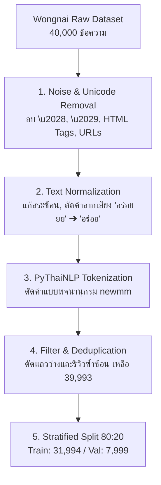
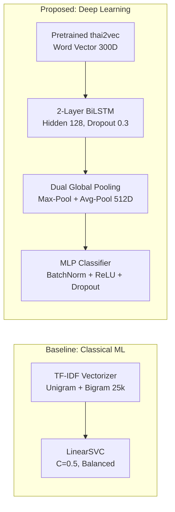

# 🍽️ Kin Nai Dee (กินไหนดี)
### Thai Food Review Consistency Inspector & Latency Benchmark Engine

[](https://www.python.org/)
[](https://pytorch.org/)
[](https://flask.palletsprojects.com/)
[](https://scikit-learn.org/)
[](https://pythainlp.org/)
[](LICENSE)
[-blue.svg)]()

> **Kin Nai Dee (กินไหนดี)** คือระบบปัญญาประดิษฐ์ตรวจสอบความสอดคล้องระหว่าง **"เนื้อหาข้อความรีวิวภาษาไทย"** กับ **"คะแนนดาวที่ผู้ใช้ให้ (1–5 ดาว)"** บนแพลตฟอร์มรีวิวร้านอาหาร (เช่น Wongnai, Google Maps, LINE MAN) เพื่อตรวจจับและแจ้งเตือนข้อผิดพลาด เช่น ลูกค้าพิมพ์ชมทุกอย่างแต่เผลอกด 1 ดาว หรือพิมพ์ด่ารุนแรงแต่กด 5 ดาวประชด (Human Error / Sarcasm) พร้อม **Dual-Model Inference Engine** เปรียบเทียบระหว่าง Classical ML และ Deep Learning แบบ Real-time

---

## 📌 สารบัญ (Table of Contents)
1. [ภาพรวมชุดข้อมูล (Dataset Description)](#1-ภาพรวมชุดข้อมูล-dataset-description)
2. [ป้ายกำกับและระดับความขัดแย้ง (Class Labels & Conflict Levels)](#2-ป้ายกำกับและระดับความขัดแย้ง-class-labels--conflict-levels)
3. [โครงสร้างไดเรกทอรี (File Structure)](#3-โครงสร้างไดเรกทอรี-file-structure)
4. [ที่มาและการเตรียมข้อมูล (Data Source & Preprocessing Pipeline)](#4-ที่มาและการเตรียมข้อมูล-data-source--preprocessing-pipeline)
5. [สถาปัตยกรรมโมเดล (Model Architectures)](#5-สถาปัตยกรรมโมเดล-model-architectures)
6. [การแบ่งชุดข้อมูล (Stratified Data Split)](#6-การแบ่งชุดข้อมูล-stratified-data-split)
7. [ผลการประเมินและการทดลอง (System Evaluation & Benchmarks)](#7-ผลการประเมินและการทดลอง-system-evaluation--benchmarks)
8. [คู่มือการติดตั้งและการใช้งาน (Deployment & Running Guide)](#8-คู่มือการติดตั้งและการใช้งาน-deployment--running-guide)
9. [คณะผู้จัดทำ (Project Credits & Team)](#9-คณะผู้จัดทำ-project-credits--team)

---

## 1. ภาพรวมชุดข้อมูล (Dataset Description)

ชุดข้อมูลที่ใช้พัฒนาคือ **Wongnai Food Review Dataset** ซึ่งเป็นคลังข้อความรีวิวร้านอาหารภาษาไทยขนาดใหญ่ สำหรับงานวิจัยด้าน **Ordinal Sentiment Classification & Inconsistency Detection**:

* **จำนวนข้อความทั้งหมด (Total Samples):** `39,993` ข้อความรีวิว (หลังผ่าน Cleansing Pipeline)
* **ระดับคะแนนดาว (Rating Classes):** 5 คลาส (`1 ดาว`, `2 ดาว`, `3 ดาว`, `4 ดาว`, `5 ดาว`)
* **ปัญหาสำคัญของข้อมูล (Key Challenge):** **Severe Class Imbalance** — คลาส 3 และ 4 ดาวมีมากถึง **77.36%** ขณะที่รีวิว 1 ดาวมีเพียง **1.04%**
* **ภาษา (Language):** ภาษาไทย (รวมคำสแลง, คำลากเสียง, คำปฏิเสธซ้อน, และการตัดคำแบบไม่มีเว้นวรรค)
* **รูปแบบไฟล์ (Format):** CSV (`cleaned_train_data.csv.zip`) พร้อม Tokenized Sequence

---

## 2. ป้ายกำกับและระดับความขัดแย้ง (Class Labels & Conflict Levels)

### 2.1 การแจกแจงระดับดาว (Rating Class Distribution)

| Class (Label) | ระดับดาว | คำอธิบายบริบทรีวิว (Review Sentiment Context) | จำนวนตัวอย่าง (Samples) | สัดส่วน (%) |
| :---: | :---: | :--- | :---: | :---: |
| `0` | ⭐ **1 ดาว** | **Critical Class:** บริการแย่มาก อาหารไม่สุก เสียความรู้สึก รอนานผิดปกติ | 415 | **1.04%** |
| `1` | ⭐⭐ **2 ดาว** | พอทานได้แต่มีข้อติชัดเจน แพงเกินคุณภาพ บริการไม่ประทับใจ | 1,845 | 4.61% |
| `2` | ⭐⭐⭐ **3 ดาว** | รสชาติมาตรฐาน ทั่วไป ปานกลาง เหมาะสมกับราคา ไม่มีอะไรโดดเด่น | 12,171 | 30.43% |
| `3` | ⭐⭐⭐⭐ **4 ดาว** | **Majority Class:** อร่อย บรรยากาศดี แนะนำ คุ้มค่า บริการรวดเร็ว | 18,768 | **46.93%** |
| `4` | ⭐⭐⭐⭐⭐ **5 ดาว** | ดีเยี่ยม ดีที่สุด ประทับใจมาก ร้านโปรด ต้องมาซ้ำ | 6,794 | 16.99% |
| **รวม** | | | **39,993** | **100.0%** |

---

### 2.2 ตรรกะการตรวจจับความขัดแย้ง (Review Consistency Logic)
คำนวณจากผลต่างสัมบูรณ์ระหว่างคะแนนดาวจริง ($Y_{\text{actual}}$) กับคะแนนที่โมเดลประเมินจากเนื้อหา ($Y_{\text{pred}}$):
$$\Delta = |Y_{\text{actual}} - Y_{\text{pred}}|$$

| ระดับความขัดแย้ง | เงื่อนไข ($\Delta$) | สถานะระบบ (Status) | การดำเนินการของระบบ (System Action) |
| :--- | :---: | :---: | :--- |
| 🟢 **Normal** | $\Delta \le 1$ ดาว | ข้อความและดาวสอดคล้องกัน | ยอมรับรีวิว ไม่แสดงเตือนรบกวนผู้ใช้ (ระบบแม่นยำ **92.94%**) |
| 🟡 **Mild Conflict** | $\Delta = 2$ ดาว | ขัดแย้งปานกลาง | แจ้งเตือนข้อความสีส้ม แนะนำให้ตรวจสอบดาวอีกครั้ง |
| 🔴 **Severe Conflict** | $\Delta \ge 3$ ดาว | **ขัดแย้งรุนแรง (วิกฤต)** | ขึ้นการ์ดเตือนสีแดง เช่น ชมเต็มที่แต่ให้ 1 ดาว หรือด่าเละแต่ให้ 5 ดาว |

---

## 3. โครงสร้างไดเรกทอรี (File Structure)

```text
Kin-Nai-Dee/
├── data/                               # คลังชุดข้อมูล
│   ├── cleaned_train_data.csv.zip      # ข้อมูล Train 39,993 ตัวอย่าง (Auto-unzip)
│   ├── cleaned_test_data.csv           # ข้อมูล Blind Test
│   └── sample_submission.csv
├── outputs/                            # โมเดลและผลลัพธ์การประเมิน
│   ├── bilstm_model.pt                 # PyTorch Weights ของ Proposed BiLSTM (~63 MB)
│   ├── bilstm_vocab.joblib             # Vocabulary & Token-to-Index Mapping
│   ├── baseline_linearsvc.joblib       # LinearSVC Trained Model (~2.18 MB)
│   ├── tfidf_vectorizer.joblib         # Fitted TF-IDF Vectorizer (25,000 Features)
│   ├── baseline_confusion_matrix.png   # กราฟ Confusion Matrix Baseline
│   ├── bilstm_confusion_matrix.png     # กราฟ Confusion Matrix BiLSTM
│   ├── model_comparison_detailed.png   # ภาพเปรียบเทียบ Confusion Matrix ข้างกัน
│   ├── tradeoff_f1_vs_latency.png      # กราฟ Trade-off ประสิทธิภาพ vs ความเร็ว
│   └── system_evaluation_and_error_analysis.md # รายงานผลระดับระบบ
├── imbalance_compare/                  # การทดลองเจาะลึกผลกระทบ Class Imbalance
│   ├── run_comparison.py               # สคริปต์รัน Ablation Study
│   ├── confusion_matrix_comparison.png
│   ├── recall_comparison_bar.png
│   └── README.md
├── web_app/                            # Interactive Web Dashboard (Flask + Vanilla CSS)
│   ├── app.py                          # Backend API & Dual Inference Controller
│   ├── run_app.bat                     # สคริปต์คลิกเดียวรัน Web Server ทันที
│   ├── static/                         # Frontend Styling & JavaScript Engine
│   └── templates/                      # UI Template Dashboard
├── presentation_script/                # สคริปต์การนำเสนอและคู่มือตอบคำถามกรรมการ
│   ├── CUE_CARDS.md                    # บัตรคิวสรุปย่อสำหรับถือดูตอนนำเสนอ
│   ├── QA_DEFENSE_GUIDE.md             # แนวทางการตอบคำถามกรรมการ 6 ข้อสำคัญ
│   └── SPEAKER_SCRIPT.md               # สคริปต์บทพูดนำเสนอเต็มรูปแบบ 11 สไลด์
├── clean_data.py                       # Data Cleansing & Tokenization Pipeline
├── train_baseline.py                   # สคริปต์ฝึกสอน Baseline (LinearSVC)
├── train_bilstm.py                     # สคริปต์ฝึกสอน Proposed Model (BiLSTM)
├── compare_models.py                   # สคริปต์ทดสอบเปรียบเทียบโมเดลเชิงลึก
├── run_system_eval_and_error_analysis.py # การวิเคราะห์ System Latency & Error Case
├── requirements.txt                    # รายการ Library Dependencies
└── README.md                           # คู่มือเอกสารฉบับสมบูรณ์
```

---

## 4. ที่มาและการเตรียมข้อมูล (Data Source & Preprocessing Pipeline)

กระบวนการทำความสะอาดข้อความถูกออกแบบขึ้นเป็นพิเศษเพื่อแก้ปัญหาเฉพาะตัวของภาษาไทยในรีวิวอาหาร:



1. **Unusual Unicode Stripping:** กรองรหัสอักขระพิเศษ `\u2028` (Line Separator) และ `\u2029` (Paragraph Separator) ที่สร้างปัญหาให้ text parser บน Windows
2. **HTML Entities & URLs Clean:** ถอดรหัสแท็ก HTML (`<br>`, `&amp;`) และลิงก์เว็บด้วย Regex
3. **Sound Elongation Reduction:** ลดทอนคำลากเสียงเกิน 2 ตัวอักษร เช่น *"อร่อยยยยยย"* $\rightarrow$ *"อร่อย"*, *"มากกกก"* $\rightarrow$ *"มาก"* เพื่อไม่ให้ Vocabulary บวมอย่างไร้ประโยชน์
4. **Thai Text Normalization:** จัดระเบียบลำดับสระและวรรณยุกต์ซ้อนผิดตำแหน่งด้วย `pythainlp.util.normalize()`
5. **Tokenization:** ตัดคำด้วย PyThaiNLP เอนจิน `newmm` (Maximal Matching)

---

## 5. สถาปัตยกรรมโมเดล (Model Architectures)

ระบบใช้แนวคิด **Dual-Model Inference Engine** เปรียบเทียบ 2 สถาปัตยกรรม:



### 5.1 Baseline Model: LinearSVC + TF-IDF
* **Feature Extraction:** TF-IDF Unigram และ Bigram (`ngram_range=(1, 2)`) สกัดคำสำคัญและคำปฏิเสธ เช่น *"ไม่ + อร่อย"*
* **Dimension:** จำกัด `max_features = 25,000`, `min_df = 3`, `sublinear_tf = True`
* **Classifier:** Linear Support Vector Classifier (`C = 0.5`, `class_weight = 'balanced'`)

### 5.2 Proposed Model: BiLSTM + Pretrained thai2vec
* **Word Embeddings:** โหลดเวกเตอร์คำศัพท์ 300 มิติจาก `thai2fit_wv` ที่ผ่านการ Pre-train จากคลังข้อความภาษาไทย ทำให้โมเดลเข้าใจความหมายของคำตั้งแต่วินาทีแรก
* **Encoder:** 2-Layer Bidirectional LSTM (`hidden_dim = 128`, `dropout = 0.3`) อ่านข้อความ 2 ทิศทาง ทั้งเดินหน้าและถอยหลัง ทำให้จับประโยคขัดแย้งปลายทางได้แม่นยำ
* **Dual Global Pooling:** รวมทั้ง **Average-Pooling** (เก็บโทนอารมณ์เฉลี่ยทั้งรีวิว) และ **Max-Pooling** (จับคำที่อารมณ์รุนแรงที่สุด) เข้าด้วยกันเป็นฟีเจอร์ 512 มิติ
* **Smoothed Class Weighting:** กำหนดค่าน้ำหนัก Loss แบบ Smooth Square Root เพื่อเพิ่มบทลงโทษเมื่อทายรีวิว 1 ดาวผิด โดยไม่ทำให้คลาสอื่น Overfit

---

## 6. การแบ่งชุดข้อมูล (Stratified Data Split)

แบ่งข้อมูลแบบ **Stratified 80:20** เพื่อล็อกสัดส่วนเปอร์เซ็นต์ของระดับดาว 1 ถึง 5 ดาวในชุด Train และ Validation ให้ตรงกัน 100%:

| ระดับดาว (Rating) | จำนวนในชุด Train (80%) | สัดส่วนใน Train | จำนวนในชุด Validation (20%) | สัดส่วนใน Val |
| :---: | :---: | :---: | :---: | :---: |
| **1 ดาว** | 332 รีวิว | 1.04% | **83 รีวิว** | **1.04%** |
| **2 ดาว** | 1,476 รีวิว | 4.61% | **369 รีวิว** | 4.61% |
| **3 ดาว** | 9,737 รีวิว | 30.43% | **2,434 รีวิว** | 30.43% |
| **4 ดาว** | 15,014 รีวิว | 46.93% | **3,754 รีวิว** | 46.93% |
| **5 ดาว** | 5,435 รีวิว | 16.99% | **1,359 รีวิว** | 16.99% |
| **รวม** | **31,994 รีวิว** | **100.0%** | **7,999 รีวิว** | **100.0%** |

---

## 7. ผลการประเมินและการทดลอง (System Evaluation & Benchmarks)

### 7.1 ตารางเปรียบเทียบประสิทธิภาพทางวิศวกรรม (Engineering Benchmarks)
*(ประเมินบน Validation Set 7,999 รีวิว จาก [outputs/system_evaluation_and_error_analysis.md](file:///d:/Kin%20nai%20dee/outputs/system_evaluation_and_error_analysis.md))*

| มิติการวัดผล (Evaluation Metric) | Baseline (LinearSVC) | Proposed (BiLSTM + thai2vec) | การวิเคราะห์เชิงวิศวกรรม |
| :--- | :---: | :---: | :--- |
| **Macro Average F1** | 0.4176 | **0.4185** | **BiLSTM ชนะ** (มีความเที่ยงธรรมในทุกคลาสมากกว่า) |
| **Critical Class: 1-Star Recall** | 14.46% (12/83) | **54.22% (45/83)** | **BiLSTM กวาดจับ 1 ดาวได้มากกว่าเกือบ 4 เท่า!** |
| **1-Star F1-score** | 0.1875 | **0.3358** | เพิ่มขึ้นเกือบเท่าตัว |
| **5-Star Recall** | 43.86% | **62.69%** | BiLSTM แยกแยะรีวิว 5 ดาวได้ขาดกว่า |
| **Within $\pm$1 Star Accuracy** | 88.37% | **92.94%** | อยู่ในเกณฑ์ยอมรับได้ ไม่ส่งผลเตือนผิดพลาด (False Alarm) |
| **Severe Error Rate ($\ge$ 2 ดาว)** | 11.63% | **7.06%** | **BiLSTM ลดความผิดพลาดร้ายแรงลงเกือบครึ่ง** |
| **Single-Request Latency (Mean)** | **4.39 ms** | 10.18 ms | ทั้งคู่ตอบสนองไวกว่าเกณฑ์ 50 ms (Real-time พร้อมใช้) |
| **Single-Request Latency (95th %)** | **5.37 ms** | 10.85 ms | ผู้ใช้ไม่รู้สึกถึงความหน่วงของเว็บ |
| **Model Size (Storage)** | **2.18 MB** | 63.25 MB | ทั้งคู่รันบน CPU สเปกทั่วไปได้โดยไม่ต้องใช้ GPU |

---

### 7.2 เจาะลึกผลกระทบของ Class Imbalance (Ablation Study ใน `imbalance_compare/`)

| ตัวชี้วัด | โมเดล A (ไม่แก้ Imbalance: Default) | โมเดล B (แก้ด้วย Balanced Weight) | ผลต่าง / การเปลี่ยนแปลง |
| :--- | :---: | :---: | :--- |
| **Accuracy** | 54.03% | 52.39% | หลอกตา (ลดลงเล็กน้อยเพราะไม่เอนเอียงเข้าคลาสใหญ่) |
| **Macro F1-score** | 0.3667 | **0.4176** | **ดีขึ้นอย่างชัดเจน** |
| **1-Star Recall** | 6.02% (แทบจับไม่ได้) | **14.46%** | **จับ 1 ดาวได้เพิ่มขึ้นก้าวกระโดด** |

---

## 8. คู่มือการติดตั้งและการใช้งาน (Deployment & Running Guide)

### 8.1 การติดตั้งสภาพแวดล้อม (Installation)

```bash
# 1. โคลน Repository
git clone https://github.com/IFillText/Kin-Nai-Dee.git
cd Kin-Nai-Dee

# 2. สร้าง Virtual Environment
python -m venv venv

# 3. เปิดใช้งาน Virtual Environment (Windows)
venv\Scripts\activate

# 4. ติดตั้ง Dependencies ที่จำเป็น
pip install -r requirements.txt
```

### 8.2 การเปิดใช้งาน Web Application

สามารถเลือกเปิดใช้งานได้ 2 รูปแบบ:
* **รูปแบบที่ 1 (คลิกเดียวรัน):** ดับเบิ้ลคลิกไฟล์ [`web_app/run_app.bat`](file:///d:/Kin%20nai%20dee/web_app/run_app.bat)
* **รูปแบบที่ 2 (ผ่าน Terminal):**
  ```bash
  python web_app/app.py
  ```
เปิดเว็บเบราว์เซอร์ไปที่: **`http://127.0.0.1:5000`**

### 8.3 การรันสคริปต์การทดลองซ้ำ (Reproducing Experiments)

```bash
# รันทำความสะอาดและเตรียมข้อมูล
python clean_data.py

# ฝึกสอน Baseline (LinearSVC)
python train_baseline.py

# ฝึกสอน Proposed Model (BiLSTM + thai2vec)
python train_bilstm.py

# เปรียบเทียบผลลัพธ์โมเดลและสร้างภาพ Confusion Matrix
python compare_models.py

# รันประเมินความเร็ว Latency Benchmark และ Error Analysis
python run_system_eval_and_error_analysis.py
```

---

## 9. คณะผู้จัดทำ (Project Credits & Team)

### 👥 คณะผู้จัดทำโครงงาน (Project Team: INTERGITY)
* โครงงานพัฒนาขึ้นภายใต้รายวิชา **Pattern Recognition & Machine Learning**

### 📚 การอ้างอิงและบรรณานุกรม (References)
* **Wongnai Challenge Dataset:** Open Review Corpus for Thai NLP Research
* **PyThaiNLP Library:** Thai Natural Language Processing Toolkit (`pythainlp`)
* **thai2vec / thai2fit:** Pretrained Thai Word2Vec Embeddings
* **Scikit-learn & PyTorch:** Classical ML & Deep Learning Frameworks
